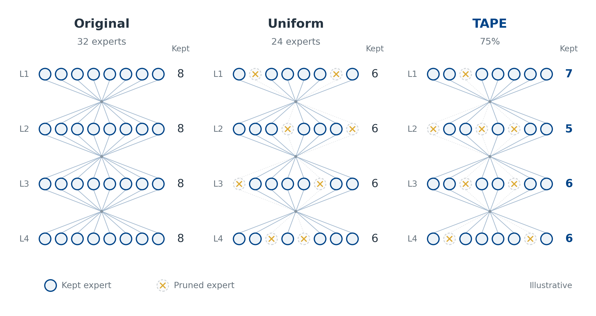
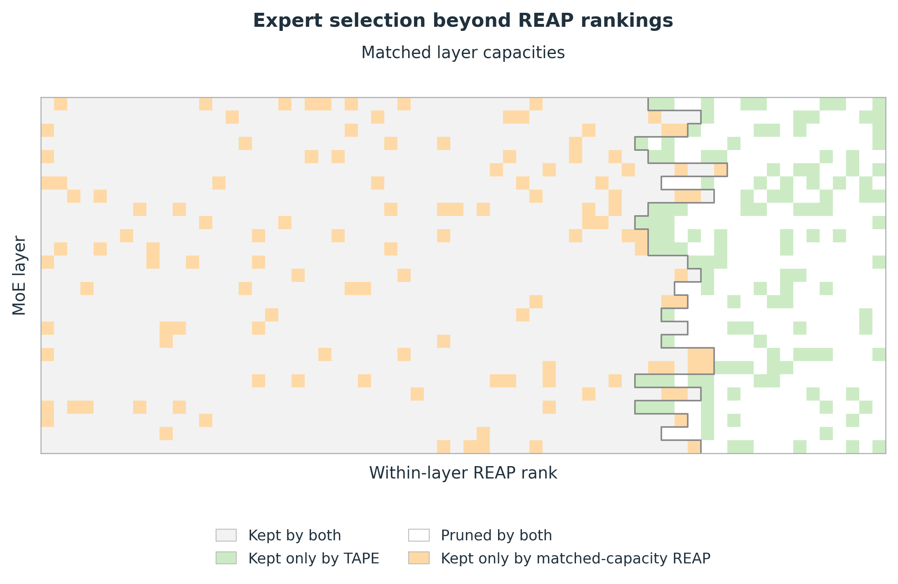

# Paper figures

The active set contains two figures. The filename identifiers `01` and `04` are retained for continuity; they correspond to Figures 1 and 2 in the current report.

| Figure | Files | Content |
|---|---|---|
| Pruning illustration | `fig01_tape_framework.{pdf,svg,png}` | Circular expert nodes with a moderate capacity change at 75% retention. |
| Expert-selection comparison | `fig04_expert_selection.{pdf,svg,png}` | TAPE and matched-capacity REAP on the ERNIE 75% reference run. |

Use PDF for the manuscript, SVG for editable vector artwork, and PNG for previews. Running the generator with `--package` creates `tape_paper_figures.zip` containing the figures, their generating code, source table, and documentation.

## Pruning illustration



Each row is an MoE layer and each circle is an expert, not an individual neuron. The original illustration has four layers of eight experts. Uniform pruning retains 6/6/6/6; TAPE retains 7/5/6/6. Both retain 24 of 32 experts. The subtitle below TAPE is `75%`, and each row has its own retained-expert count. Removed identities vary by row; uniform capacities do not imply identical retained positions.

The small network, counts, and connecting lines are schematic, not an experimental model configuration. The illustration uses blue/gold outlines from [Paul Tol's high-contrast palette](https://sronpersonalpages.nl/~pault/), with dashed outlines and crosses distinguishing pruned experts.

Caption:

> **Expert pruning under a fixed global budget.** Each row represents an MoE layer, circles represent experts, and the adjacent number gives its retained count. Uniform pruning keeps six experts per layer, whereas the illustrative TAPE allocation keeps 7, 5, 6, and 6 under the same total budget. Counts and connections are schematic rather than experimental model capacities.

## Expert-selection comparison



The data come from the seed-6707 ERNIE 75% run. Rows represent 27 MoE layers, and experts are ordered by within-layer REAP rank. The outline marks the REAP cut-off when each layer has exactly the final TAPE capacity. TAPE and matched-capacity REAP score 62.67% and 58.07% Avg, respectively; these are single-run diagnostic scores, not three-seed means.

| Category | Colour | Experts |
|---|---|---:|
| Kept by both | Pale gray `#F2F2F2` | 1,168 |
| Pruned by both | White `#FFFFFF` | 304 |
| Kept only by TAPE | Light green `#CCEBC5` | 128 |
| Kept only by matched-capacity REAP | Light orange `#FED9A6` | 128 |

The green/orange pair follows [ColorBrewer Pastel1](https://colorbrewer2.org/export/colorbrewer.json). The exported image has no numeric annotations: tick numbers, test scores, and legend counts are hidden. Category labels and the capacity outline remain. No explanatory text is printed below the legend.

Caption:

> **Expert-selection differences at matched layer capacities.** Experts are ordered by within-layer REAP rank across the 27 MoE layers. The stepped boundary marks REAP selection under the final TAPE capacities. TAPE keeps 128 experts excluded by this ranking and removes 128 that it retains. The two expert sets score 62.67% and 58.07% Avg, respectively.

The portable source is [`artifacts/expert_analysis/expert_status.csv`](../../artifacts/expert_analysis/expert_status.csv). This set-level comparison does not isolate the causal contribution of individual experts or establish a depth preference.

## Reproduce

Run from the repository root:

```bash
python3.10 -m venv .venv-figures
.venv-figures/bin/python -m pip install -r requirements-figures.txt
.venv-figures/bin/python scripts/generate_paper_figures.py --package
```

The command loads no models and runs no experiments. The source table and the figure code above fully specify both visualizations.
